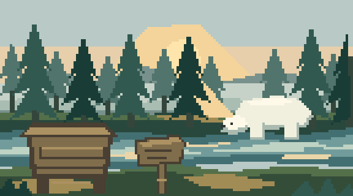

# Terminal Renderer

Describe a place and what the player can do there. A text model generates a fixed-camera pixel scene with numbered objects, dialogue, and state changes. Run it in a truecolor terminal, or use the standalone Python encoder to display your own RGB framebuffer.



## Play

Use Python 3.11 or newer on macOS or Linux, in a UTF-8 terminal with ANSI truecolor, alternate-screen support, and the `▀` glyph. The package has no third-party runtime dependencies.

From this checkout, run the bundled tavern:

```sh
python3.11 demo.py
```

Press **1** to read the wet letter, **2** to speak to the innkeeper, or **3** to inspect the back door. Press **Q** or **Ctrl-C** to return to the shell. The tavern fits at its native resolution in 145 columns and 44 rows, and scales down in smaller windows.

To install the package from the checkout and run the greenhouse:

```sh
python3.11 -m pip install .
terminal-renderer --example greenhouse
```

Try **3 → 1 → 3** to check the locked gate, find the key, and open the gate. The same options work with `python3.11 -m terminal_renderer` and `python3.11 demo.py`.

## Generate and replay scenes

Use a recent [Codex CLI](https://developers.openai.com/codex/cli) signed in with ChatGPT. Check the session with `codex login status`.

```sh
terminal-renderer --provider codex \
  --prompt "A moonlit greenhouse. Light a brass lantern to find the key, inspect a seed tray, and unlock the iron gate." \
  --save-scene greenhouse.json

terminal-renderer --scene greenhouse.json
```

The model writes the scene and dialogue before play. Object state lasts for the current play session. Use `--model` to specify the generation model.

The default provider is Codex CLI, or the API if `OPENAI_API_KEY` or `OPENAI_BASE_URL` is set. Use `--provider api` to select a Chat Completions endpoint that supports JSON mode. The API backend defaults to `gpt-4.1-mini` and also accepts `OPENAI_MODEL`.

### Scene format

The [greenhouse example](examples/greenhouse.json) shows a version 2 scene. Background art uses canvas coordinates on a 144 × 80 frame. Each object has a fixed `[x, y, width, height]` rectangle. Its `art` and `active_art` shapes use coordinates local to that rectangle. The active sprite replaces the initial sprite when the object is used successfully.

- `["rect", "color", x, y, width, height]` draws a rectangle in a named palette color.
- `["poly", "color", [x1, y1], [x2, y2], [x3, y3], ...]` draws a polygon with 3 to 12 vertices.
- `requires` and `blocked` define a prerequisite and its dialogue. `text` describes the successful action, and `revisit` describes the resulting state on a repeat press.

Saved version 1 scenes use absolute object coordinates and overlay art. The terminal viewer also accepts static scenes with an empty object list.

## Benchmark results

The [16 November 2026 run](evaluation/published/2026-11-16/README.md) compared eight GPT models on five cases at medium reasoning. **17 of 40 responses passed format validation.**

- [Gallery HTML](evaluation/published/2026-11-16/gallery.html) contains all 17 valid scenes and 87 captured frames. Download the file and open it in a browser.
- [Run CSV](evaluation/published/2026-11-16/summary.csv) records all 40 attempts with timing, token usage, estimated API-equivalent cost, and validation status.
- [Evaluation protocol](evaluation/README.md) documents the prompts, checks, and benchmark runner.

## Python API

```python
from terminal_renderer import encode_frame

frame = [[(220, 140, 70)], [(32, 48, 80)]]
encoded = encode_frame(frame)
```

`encode_frame(rows, *, pad=(0, 0, 0))` takes a rectangular sequence of RGB triples. It encodes each vertical pair as a truecolor half-block, pads odd-height frames with the supplied color, and resets colors at the end of every terminal row. The caller handles sizing and terminal writes.

Run the test suite from the repository root:

```sh
python3.11 -m unittest -v
```
